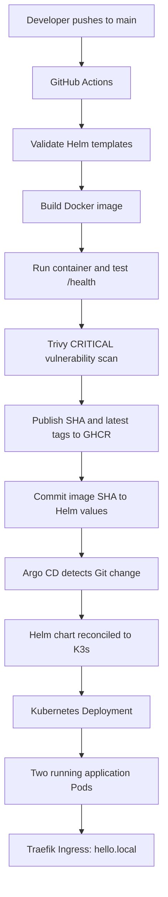

# Hello DevOps — CI/CD and GitOps on K3s

A Python Flask application deployed to a local, two-node K3s cluster. This project demonstrates an application delivery path in which GitHub Actions builds, tests and scans a container image, publishes it to GitHub Container Registry (GHCR), updates the Helm image tag in Git, and Argo CD reconciles that desired state into Kubernetes.

This is a hands-on DevOps homelab project, not a claim of production readiness.

## Project highlights

- **Application:** Flask homepage and JSON health endpoint at `/health`.
- **Container:** Docker image running the application with Gunicorn and a container health check.
- **CI:** GitHub Actions validates Helm templates, builds the image, starts it, and tests its health endpoint.
- **Security gate:** Trivy scans the built image for CRITICAL vulnerabilities. The current workflow ignores unfixed findings.
- **Registry:** Images are published to GHCR with both the source commit SHA and `latest` tags.
- **GitOps:** The workflow commits the new image SHA to `helm/hello-devops/values.yaml`; Argo CD watches the Helm chart and automatically reconciles changes.
- **Kubernetes:** K3s runs two application replicas across the master and worker nodes.
- **Networking:** Traefik Ingress serves `hello.local`; the Service is configured as NodePort `30080`.

## Architecture



The Git repository is the desired-state source for the Helm release. The workflow publishes the image first and then updates the chart values with the exact source commit SHA. Argo CD performs the Kubernetes deployment; GitHub Actions does not directly run `kubectl apply`.

## Technology stack

| Area | Technology |
|---|---|
| Application | Python, Flask |
| WSGI server | Gunicorn |
| Containerization | Docker |
| Source control | Git, GitHub |
| CI/CD workflow | GitHub Actions |
| Image registry | GitHub Container Registry (GHCR) |
| Image scanning | Trivy |
| Orchestration | Kubernetes on K3s |
| Deployment packaging | Helm |
| GitOps | Argo CD |
| Ingress | Traefik |

## Repository structure

```text
hello-devops/
├── .github/
│   └── workflows/
│       └── ci-cd.yml
├── app.py
├── Dockerfile
├── requirements.txt
├── helm/
│   └── hello-devops/
│       ├── Chart.yaml
│       ├── values.yaml
│       └── templates/
├── k8s/
│   ├── configmap.yaml
│   ├── hello-devops-ingress.yaml
│   └── hello-devops.yaml
└── README.md
```

## CI/CD and GitOps flow

The workflow is defined in [`.github/workflows/ci-cd.yml`](.github/workflows/ci-cd.yml). It runs for pushes and pull requests targeting `main`.

### Validation and CI

1. Check out the repository.
2. Render the Helm chart with its default configuration and validate the Deployment, Service, ConfigMap and Ingress.
3. Confirm that the HorizontalPodAutoscaler is absent when autoscaling is disabled, and present when autoscaling is enabled for the validation render.
4. Build the Docker image using the source commit SHA as its local tag.
5. Start the container and poll `/health` until it responds or the test fails.
6. Scan the image with Trivy for CRITICAL vulnerabilities. The current workflow sets `ignore-unfixed: true` and scans OS and library vulnerabilities.

### Publish and deploy from `main`

For a push to `main`, after the validation, application test and Trivy scan pass, the workflow:

1. Authenticates to GHCR using the GitHub Actions token.
2. Pushes `ghcr.io/parv166/hello-devops:<commit-sha>` and `ghcr.io/parv166/hello-devops:latest`.
3. Updates `image.tag` in `helm/hello-devops/values.yaml` to the exact source commit SHA.
4. Commits that Helm change using the GitHub Actions bot.

Argo CD tracks this repository's `main` branch and the `helm/hello-devops` path. Automated sync is enabled with `selfHeal: true` and `prune: false`. Argo CD applies the changed Helm desired state, and Kubernetes performs the Deployment rollout.

**Important:** The cluster needs permission to pull the GHCR package. This project references an image pull Secret named `ghcr-secret` in the `hello-devops` namespace. The Secret is managed in the cluster and should not be committed to Git.

## Kubernetes deployment

The current cluster has two K3s nodes:

- Master: `pc-vmware-virtual-platform`
- Worker: `hello-worker`

The Helm values currently configure:

| Setting | Current value |
|---|---|
| Namespace | `hello-devops` |
| Deployment | `hello-devops` |
| Replicas | `2` |
| Image repository | `ghcr.io/parv166/hello-devops` |
| Image pull Secret | `ghcr-secret` |
| Service type | `NodePort` |
| NodePort | `30080` |
| Ingress controller | Traefik |
| Ingress host | `hello.local` |
| Ingress path | `/` |
| Application environment | `kubernetes` |
| CPU request / limit | `50m / 500m` |
| Memory request / limit | `64Mi / 256Mi` |
| HPA | Disabled in the current values |

The Helm chart supports optional HPA rendering. The CI workflow checks both the default (disabled) and enabled chart render. The current cluster configuration uses two fixed replicas because `autoscaling.enabled` is `false`.

The chart also references an existing Kubernetes Secret named `hello-devops-secret` for the application's Flask secret configuration. Create required Secrets in the target namespace before deploying; do not store credentials in `values.yaml` or this README.

## Run locally

Create and activate a Python virtual environment, install the dependencies, and start the Flask development server:

```bash
python3 -m venv .venv
source .venv/bin/activate
pip install -r requirements.txt
python app.py
```

Test the application:

```bash
curl http://127.0.0.1:5000/
curl http://127.0.0.1:5000/health
```

Build and run the container:

```bash
docker build -t hello-devops:local .
docker run --rm -p 5000:5000 hello-devops:local
```

Then test `http://127.0.0.1:5000/` and `http://127.0.0.1:5000/health`.

## Verify the cluster

Run these commands on the K3s host:

```bash
# Nodes
sudo k3s kubectl get nodes -o wide

# Argo CD application
sudo k3s kubectl get application hello-devops -n argocd

# Deployment and Pods
sudo k3s kubectl get deployment hello-devops -n hello-devops
sudo k3s kubectl get pods -n hello-devops -o wide

# Confirm the exact image deployed
sudo k3s kubectl get deployment hello-devops -n hello-devops \
  -o jsonpath='{.spec.template.spec.containers[0].image}{"\n"}'

# Wait for a rollout to finish
sudo k3s kubectl rollout status deployment/hello-devops -n hello-devops
```

Test the Ingress using a K3s node IP. Replace `<NODE-IP>` with the address of a node reachable from your machine:

```bash
curl -H "Host: hello.local" http://<NODE-IP>/
curl -H "Host: hello.local" http://<NODE-IP>/health
```

The homepage should return the HTML page. The health endpoint should return JSON with `"status":"healthy"`.

## End-to-end validation performed

A real application change was used to validate the pipeline:

- Changed the homepage heading from **Hello, World!** to **Hello, GitOps!**.
- Pushed the application change to `main`.
- GitHub Actions built, tested, scanned and published the image.
- The workflow committed the new SHA image tag to the Helm values file.
- Argo CD reconciled the Helm change and Kubernetes completed the rollout.
- Verified that two Pods were `1/1 Running`, distributed across the K3s master and worker.
- Verified the homepage returned `Hello, GitOps!` and `/health` returned `"status":"healthy"`.

## Current limitations and next improvements

This is a local homelab project. The following areas still need work before it should be treated as production-ready:

- HTTPS/TLS is not configured for the current Ingress.
- Monitoring, centralized logs and alerting are not set up as part of this project.
- Backup and disaster-recovery procedures are not documented or tested.
- GHCR and application Secrets are managed separately from Git; a documented rotation process and a dedicated secret-management solution would improve this.
- Trivy's current gate focuses on CRITICAL findings and ignores unfixed vulnerabilities; it is not a complete security assessment.
- The current HPA setting is disabled; autoscaling behavior should be separately load-tested if enabled.

## Useful links

- [GitHub repository](https://github.com/parv166/hello-devops)
- [GitHub Actions workflow](https://github.com/parv166/hello-devops/actions)
- [Helm chart](./helm/hello-devops)
- [CI/CD workflow source](./.github/workflows/ci-cd.yml)

---

Built as a hands-on DevOps project to learn containerization, CI, image security scanning, Kubernetes, Helm and GitOps with Argo CD.

